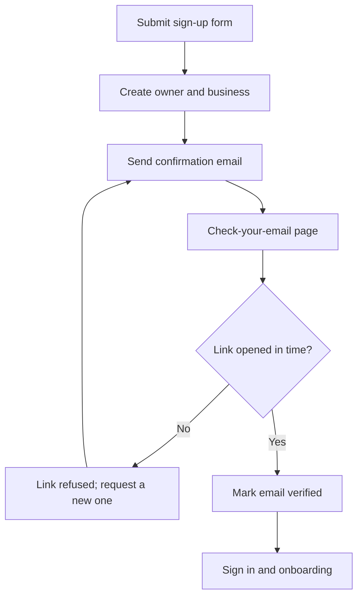
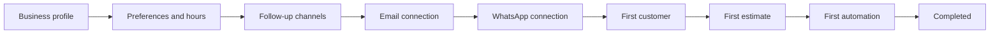
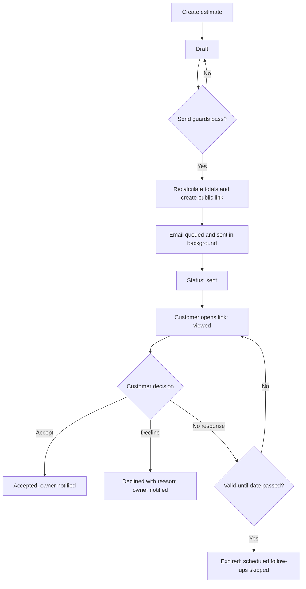
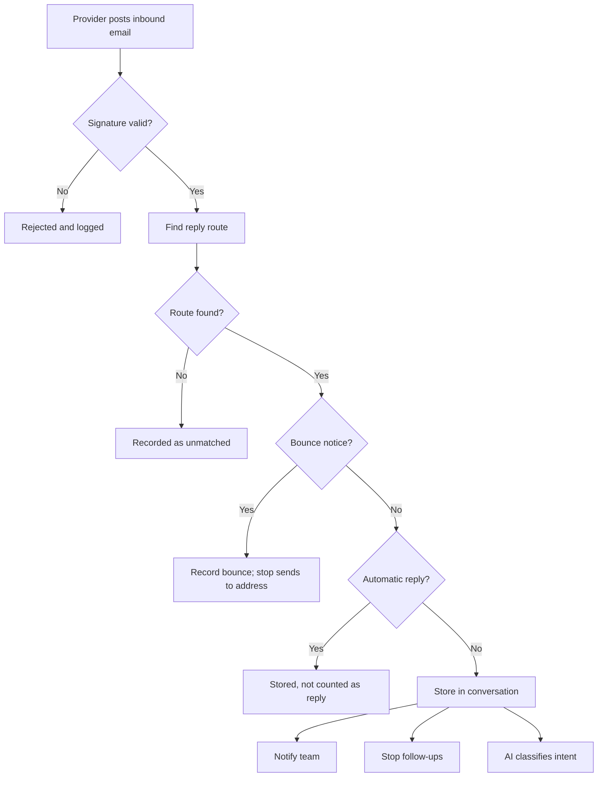
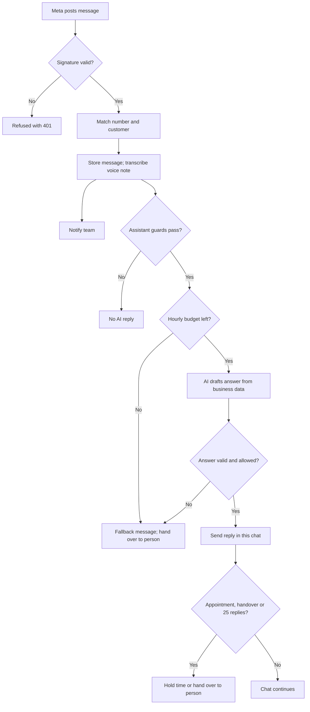
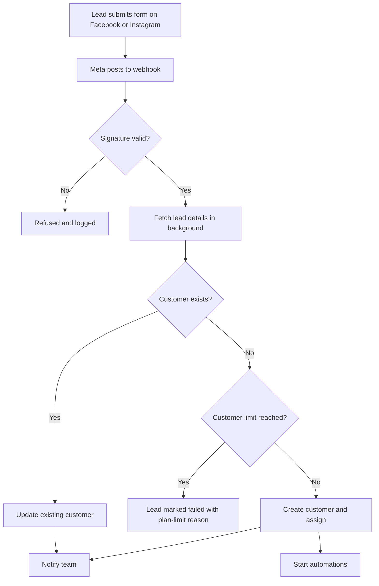
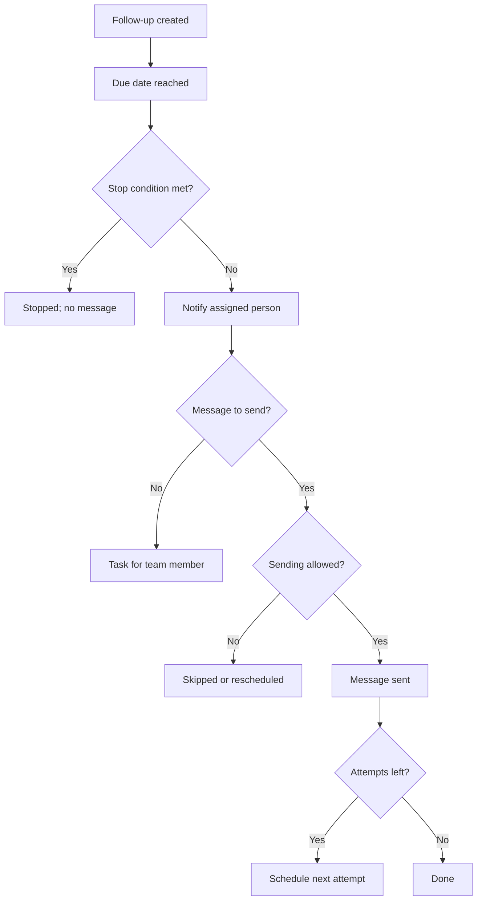
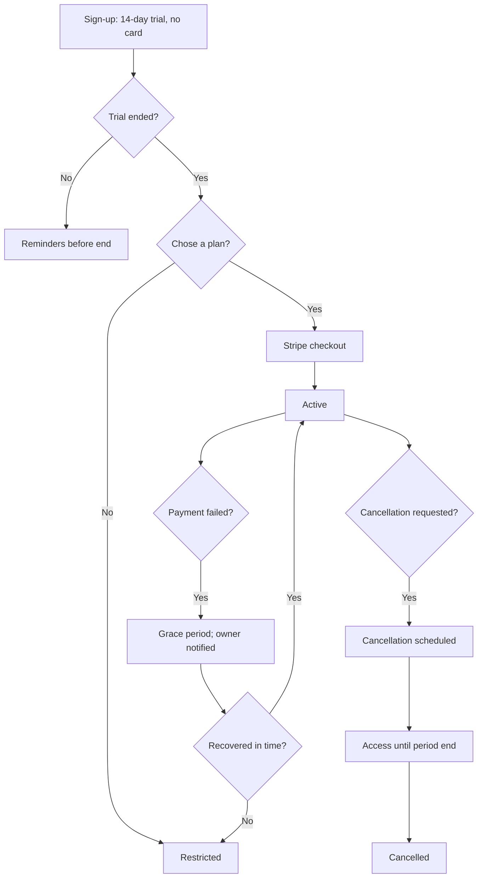
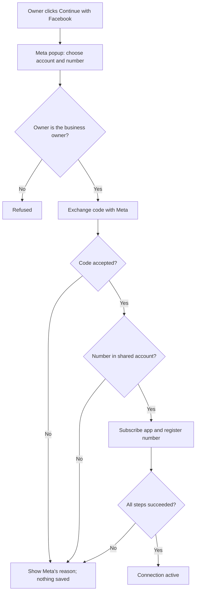
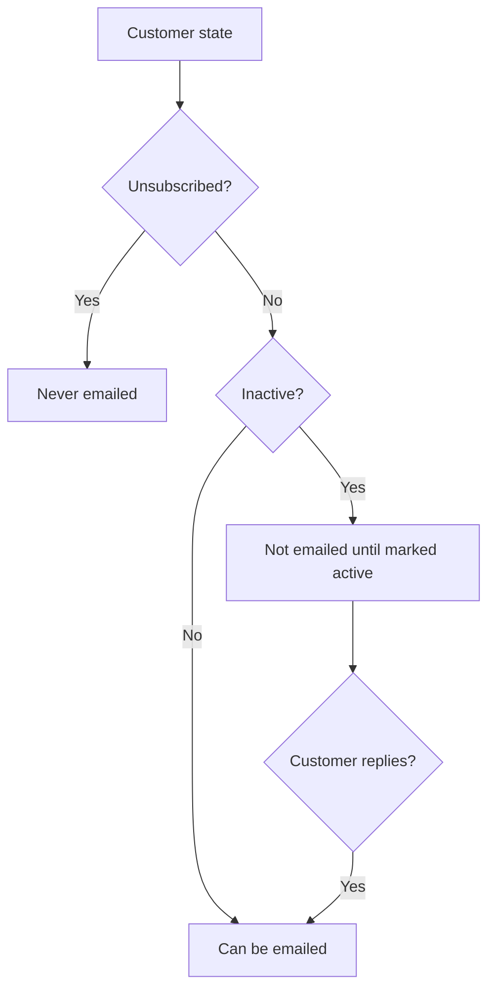

# QuoteFlow: Workflows

This document describes how the main processes move through the app, step by step. Each flow has a numbered list and a diagram. The diagrams use Mermaid and render on GitHub.

It complements `docs/APP_AUDIT.md`, which records what was built and why. Where a flow is described in more detail in another document, that document is linked.

**Conventions**
- Steps marked *(background)* run as queued jobs, not inside the web request.
- A *guard* is a check that must pass before the next step. If a guard fails, the flow stops and the user or customer sees a plain-language reason.
- Every background job is safe to run twice or late. See `docs/queue-reliability.md`.

---

## 1. Sign-up and email verification

Creates a business owner account and confirms the email address.

1. The visitor submits the sign-up form with business name, name, email and password.
2. The app creates the owner account and the business (organization) in one step.
3. A confirmation email is sent to the address.
4. The owner is taken to a "Check your email" page. Pages in the app are blocked until the email is confirmed.
5. The owner opens the link. The link is signed and expires after its time limit.
6. The app marks the address as verified. It works in any browser, including one where nobody is signed in.
7. The owner signs in and goes to onboarding.



**Guard:** an unverified owner cannot open business pages. An expired or altered link does not verify anything.

---

## 2. Onboarding

Brings a new business to its first working setup. The steps are defined in `app/Enums/Onboarding/OnboardingStep.php`.

1. Business profile (name, logo, contact details).
2. Business preferences (timezone, currency, country, opening hours).
3. Follow-up channels (email, WhatsApp, or both, and the primary channel).
4. Email connection (sending domain or account).
5. WhatsApp connection (optional, see section 10).
6. First customer.
7. First estimate.
8. First automation.
9. Completed. The checklist disappears from the dashboard.



**Note:** steps can be skipped and returned to from the checklist. Each step shows its status.

---

## 3. Quote (estimate): create, send, respond

Covers the path from a draft quote to the customer's decision.

1. A team member creates an estimate with items, discounts, tax and a "valid until" date.
2. The estimate is saved as a **draft**. Drafts can be edited and are not visible to customers.
3. **Send (guards):**
   - the estimate is still a draft and not cancelled;
   - it has at least one item and a total above zero;
   - the "valid until" date has not passed;
   - the customer has a valid email address, has not opted out of email, and is active;
   - the customer has not already accepted another version.
4. Totals are recalculated from the stored items, so what is sent is always consistent.
5. A public link with a secret token is created. Only a hash of the token is stored.
6. The email is queued and sent *(background)* from the business's verified sending channel. The sending is recorded in the customer's conversation.
7. The estimate status becomes **sent**.
8. The customer opens the public link. Opening it marks the estimate **viewed**.
9. The customer chooses **Accept** or **Decline** (with an optional reason and note).
10. The app records the decision and notifies the creator and the owner and managers.
11. If the estimate passes its "valid until" date without a decision, it **expires** and any follow-ups scheduled for it are skipped. Accepted, declined and cancelled estimates never expire.



---

## 4. Customer reply by email

A customer replies to a quote or follow-up email.

1. The email provider posts the inbound message to the app's webhook. The webhook is verified and logged.
2. *(background)* The app finds the reply route for the address. The route tells it which business and conversation the reply belongs to. If no route matches, the message is recorded as unmatched.
3. The message is stored in that conversation, threaded to the original email.
4. **Bounce check:** if the message is a bounce notice, the app records it against the original message and stops future sends to that address.
5. **Automatic reply check:** out-of-office and automatic replies are recognised and do not count as a customer reply.
6. The conversation is marked as having a new reply.
7. *(background)* If AI classification is enabled, the reply is classified for intent (ready to book, negotiating, needs attention). The AI only analyses the reply; it does not send or change anything.
8. Team members are notified (the owner and managers, plus whoever has an open follow-up with the customer).
9. Follow-ups for that customer stop, because a real reply has been received.



See also `docs/email-inbound-replies.md` and `docs/ai-reply-classification.md`.

---

## 5. Customer message on WhatsApp and the AI assistant

A customer writes to the business's WhatsApp number.

1. Meta posts the message to the app's webhook. The request is checked with the app's signature. Requests that fail the check are refused.
2. *(background)* The message is matched to a connected WhatsApp number and a customer. A new customer is created for an unknown number.
3. Text, photos, documents and voice notes are stored. Voice notes are transcribed *(background)* before the AI looks at them.
4. The message is shown in the customer's conversation and the team is notified.
5. If AI classification is on, the message is classified.
6. **Assistant guards.** The assistant answers only when all of these are true:
   - the business has switched the assistant on, and its plan includes it;
   - this is the customer's latest message, and nobody has already answered it;
   - no person from the business has written to this customer in the last 30 days (automated messages do not count);
   - the customer's lead is not already Won or Lost;
   - the business has hourly AI budget left (section 5a below).
7. The assistant waits a few seconds, then builds its answer from the business profile, weekly opening hours, the customer's quotes and the conversation so far *(background)*.
8. The AI's answer is treated as untrusted. It must match the response schema. The app then checks it and allows only three actions:
   - send a reply in this chat;
   - mark the lead Qualified;
   - hand the chat over to a person.
9. If the customer picked an appointment time, the time is held for a person to confirm. The chat is handed over.
10. After 25 replies in one chat, the chat is handed over.
11. If every AI model is unavailable, the customer gets a short "a team member will reply" message in their language, and the chat is handed over.

### 5a. Hourly AI budget
- Each business gets a plan-based number of replies per hour: Free 30, Starter 60, Pro 150.
- When the hour's budget is used up, the customer gets the fallback message and the chat is handed over.
- The owner and managers are notified at 80% and at 100%.



**Limits:** the assistant cannot accept or change a quote, cannot book without a person's confirmation, and cannot contact anyone other than the customer in the current chat. See `docs/APP_AUDIT.md`, section 9.4.

---

## 6. Facebook and Instagram lead ad

A lead fills in a lead form on Facebook or Instagram.

1. The business has connected its Facebook Page (Settings → Lead Ads).
2. Meta posts the lead to the app's Lead Ads webhook. The request is checked and logged.
3. *(background)* The lead's details are fetched from Meta and the form is identified.
4. The lead is matched to a customer by email or phone. If there is no match, a new customer is created, subject to the plan's customer limit.
5. A duplicate form fill updates the same customer and does not create a new one.
6. The customer is assigned to the page's assigned team member, if one is set.
7. If the page allows WhatsApp contact, the lead is marked for WhatsApp consent. Consent is still required before a WhatsApp message is sent.
8. The "customer created" event starts any matching automations.
9. The owner and managers, and the assigned member, are notified.
10. If a step fails, the lead is marked failed with the reason. For a plan-limit failure, the reason says the customer limit was reached; the lead can be imported again once the limit allows it.



---

## 7. Automation run

Owners build rules: WHEN → WAIT → IF → THEN. Each run is recorded.

1. A trigger event happens (for example, a customer is created, a reply arrives, an estimate is accepted).
2. *(background)* The app finds the automations for that trigger and checks each one's conditions (IF).
3. If the rule has a WAIT step, the run is paused and resumed later *(background)*.
4. Each action runs in order. Actions are idempotent: a retry does not repeat a completed action.
5. Email and WhatsApp actions go through the same consent, opt-out and window rules as manual messages.
6. Each action's outcome is written to the run's log.
7. A failed action marks the run failed and notifies the automation's owner and the owner and managers.
8. A suspended business's automations do not run.

```mermaid
flowchart TD
    A[Trigger event] --> B[Find automations for trigger]
    B --> C{Conditions (IF) met?}
    C -- No --> Z[Skipped; logged]
    C -- Yes --> D{WAIT step?}
    D -- Yes --> E[Paused; resumed later]
    E --> F
    D -- No --> F[Run actions in order]
    F --> G{Action allowed by consent and opt-out?}
    G -- No --> H[Action skipped; logged]
    G -- Yes --> I[Send or update]
    I --> J{Failed?}
    J -- Yes --> K[Run failed; owner notified]
    J -- No --> L[Logged as complete]
```

See `docs/automations.md` and `docs/automation-foundation.md`.

---

## 8. Follow-up

Reminds the team, or the customer, when a quote or lead is still waiting.

1. A follow-up is created for a customer or estimate, with a due date and an assigned person.
2. Before it is due, the team sees it on the dashboard and in Reminders.
3. When it is due, the assigned person is notified.
4. If the follow-up sends a message, the message is sent through the same rules as any other (consent, opt-out, inactive customers, WhatsApp window).
5. Repeat follow-ups up to the chosen number of attempts are scheduled.
6. Follow-ups stop when: the customer replies; the estimate is accepted, declined or expires; the customer is marked inactive; or the owner completes or skips it.
7. A send that is deferred by a WhatsApp limit is rescheduled, not lost.



See `docs/follow-ups.md`.

---

## 9. Billing lifecycle

Controls plans, trials, failed payments and cancellations. Stripe is the payment provider. The app keeps its own record and checks it against Stripe's webhooks.

**Trial**
1. A new business starts a 14-day trial without a card.
2. Reminders are sent before the trial ends.
3. When the trial ends, the business is restricted unless it chooses a plan.
4. Choosing a plan starts Stripe checkout. When the webhook confirms payment, the business becomes active.

**Failed payment**
1. A payment fails. Stripe sends a webhook.
2. The owner is notified and the business enters a grace period.
3. If the payment is recovered during the grace period, the business stays active and the owner is told.
4. If not, paid features are paused (restricted).

**Cancellation**
1. The owner requests cancellation. The app records the cancellation as scheduled.
2. Access continues until the end of the paid period.
3. At the period end, the subscription becomes cancelled and the owner is notified.

**Limits**
- Each action that uses a plan limit (customers, AI conversations, and so on) is checked before it runs. If the limit is reached, the action is refused and the owner sees an upgrade prompt.



See `docs/billing.md`.

---

## 10. WhatsApp one-click connect

Connects a business's WhatsApp number through QuoteFlow's Meta app.

1. The owner (only the owner may connect) selects **Continue with Facebook** on Settings → WhatsApp.
2. Meta's sign-in popup asks the owner to choose the WhatsApp Business account and number to share.
3. The app receives a one-time code and the chosen account and number.
4. **Guards:**
   - the code is exchanged with Meta and accepted;
   - the number is inside the account the owner shared;
   - the number is subscribed to QuoteFlow's app.
5. The app registers the number and checks its display name and phone number.
6. The connection is saved as active. The webhook secret is taken from the app, not stored per business.
7. If any step fails, nothing is saved and the page shows Meta's reason in plain language.
8. Disconnecting unsubscribes QuoteFlow's app from the account.



See `docs/whatsapp-one-click-connect.md`.

---

## 11. Customer opt-out and inactive status

1. A customer may opt out of email (an unsubscribe link is in every email). Opted-out customers are never emailed.
2. A customer with no reply for the set period may be marked inactive. Inactive customers are not emailed until someone marks them active again.
3. A reply from an inactive customer marks them active again, and is recorded.
4. Sending to an opted-out or inactive customer is refused with a plain-language reason.



See `docs/customers-and-conversations.md`.

---

## 12. Workflow ownership and audit trail

- Each workflow that changes business data records who did it and when, in the business's activity log.
- Platform administration actions (for example, changing a plan or a limit) are written to the platform audit log.
- Notifications are sent to the people responsible for the workflow. Preferences for each notification type can be changed in Settings.

See `docs/admin-audit.md` and `docs/team-and-settings.md`.
